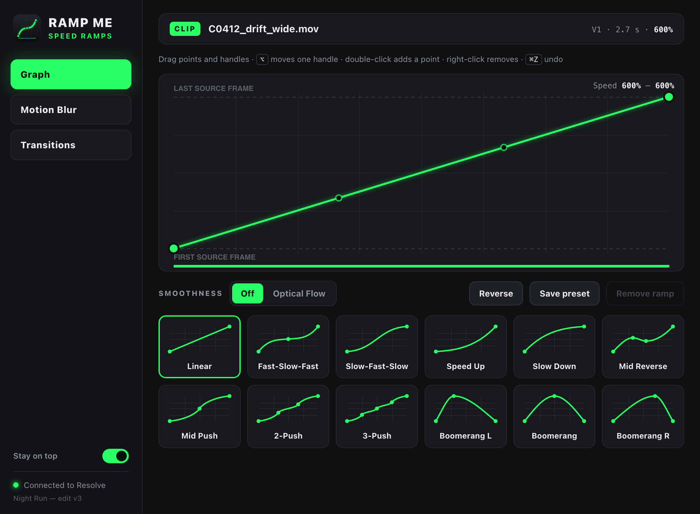
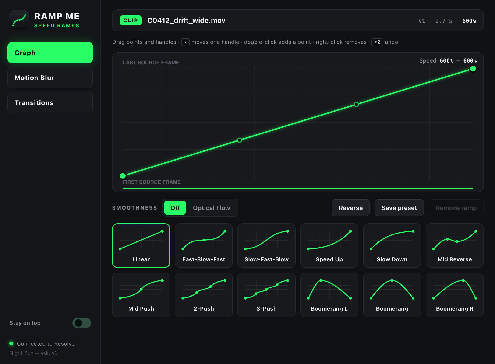

# Ramp Me

One-click speed ramps for DaVinci Resolve Studio, plus motion blur and
transition effects. A Workflow Integration plugin (macOS).

**[Website and live demo →](https://grozoww.github.io/ramp-me/)**




## Install

Needs **DaVinci Resolve Studio** (plugins do not run in the free version).

```bash
scripts/install.sh
```

Restart Resolve, then open **Workspace → Workflow Integrations → Ramp Me**.
Re-run the script after updating the code (no restart needed then, just reopen
the plugin).

## Use

**Graph**

1. Speed the clip up on the edit page first, e.g. to 600% with Retime Controls
   (`⌘R`), so it fits your music.
2. Park the playhead on the clip and click a preset.
3. Drag points and handles to adjust. Changes go to Resolve live.

The clip keeps its timeline length and its first and last source frame. Only
the speed inside changes. On a 600% clip the slow parts of the presets land
near 100%, so they show real frames.

- `⌥`-drag a handle to move it alone, double-click to add a point,
  right-click a point to remove it, `⌘Z` / `⇧⌘Z` undo and redo (per clip).
- **Smoothness → Optical Flow** blends between frames with Fusion's optical
  flow. Smoother, but slower to play back.
- **Reverse** plays the clip backwards. **Save preset** keeps your curve.
- The bar under the graph shows speed: blue ≤ 110%, green normal,
  yellow ≥ 1500%, pink backwards.

The window stays above Resolve. Turn that off with **Stay on top** at the
bottom of the sidebar.

**Motion Blur / Transitions**

Put an adjustment clip over the cut and park the playhead on it, then switch
effects on. They fade in and out over the adjustment clip (Peak: Start,
Middle, End or Full). Move or trim the adjustment clip and the plugin re-fits
the effects. Without an adjustment clip, the effects cover the clip under the
playhead.

## How it works

Resolve's scripting API cannot set clip speed or the retime curve. Ramp Me
works in the clip's **Fusion comp** instead:

- Comp time runs in source frames, and the edit-page speed is applied after
  Fusion. A `TimeStretcher` node (`RampMe`) with a keyframed `SourceTime`
  remaps time inside the clip's source range.
- Optical flow uses `Dimension.OpticalFlow` → `Dimension.FlowStretcher`.
- Resolve ignores Fusion comps that a script adds to an adjustment clip. So an
  adjustment clip only marks a time range: its effects are written into the
  comps of the video clips under it (`RMfx_<id>_*` nodes before `MediaOut`),
  with an envelope expression over that range.
- The plugin keeps its state in comp data (`RampMe.state`, `RampMe.fx.<id>`),
  so a clip shows its curve again when you come back to it.

Your own Fusion nodes stay: the ramp goes right after `MediaIn`, effects right
before `MediaOut`.

## Develop

```bash
node --test test/*.test.js          # curve math, timecode, Lua generation
scripts/install.sh --dev            # install with dev hooks
scripts/dev-sync.sh                 # copy changes; UI reloads by itself
scripts/dev-run.sh some-script.js   # run JS inside the plugin (gets ctx.bridge, ctx.win)
node scripts/make-icon.js           # redraw plugin/img/icon.svg + icon.png (needs Chrome)
scripts/build-site.sh --shots       # copy the UI into docs/demo, re-render docs/img shots
```

The website in `docs/` is served by GitHub Pages. `docs/demo` is the plugin UI
running on `site/demo-mock.js`; rebuild it after changing `plugin/ui`.

Changes to `main.js` or `lib/` need the plugin window closed and reopened.
Errors that would close the window are logged to
`~/Library/Application Support/RampMe/plugin.log`. Presets and settings live
in `prefs.json` next to it.

## Limits

- Studio only, macOS only for now (the code has no Mac-only parts besides the
  install script and paths).
- A clip with several Fusion comp versions: the plugin edits the first one.
- Very long timelines (hundreds of clips) make the playhead tracking slower;
  the plugin rescans the timeline every 1.5 s.

## License

MIT, see [LICENSE](LICENSE). `WorkflowIntegration.node` belongs to Blackmagic
Design; it is not in this repo, the install script copies it from your Resolve.
